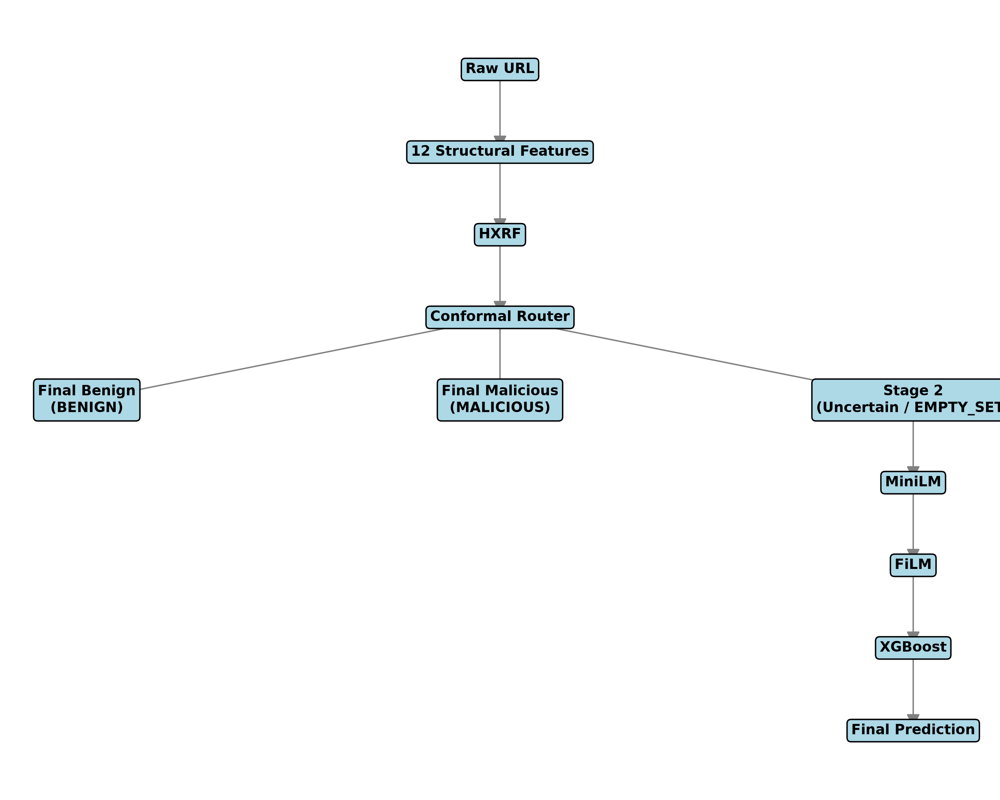
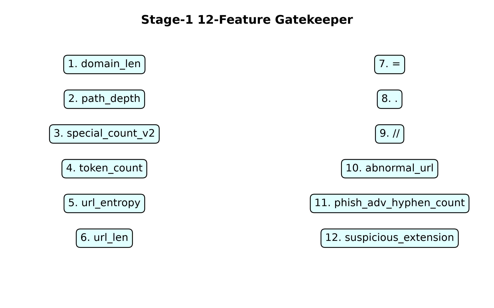
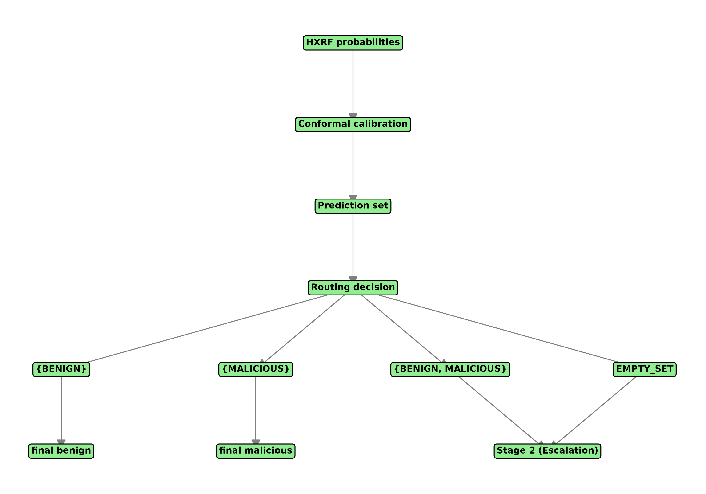
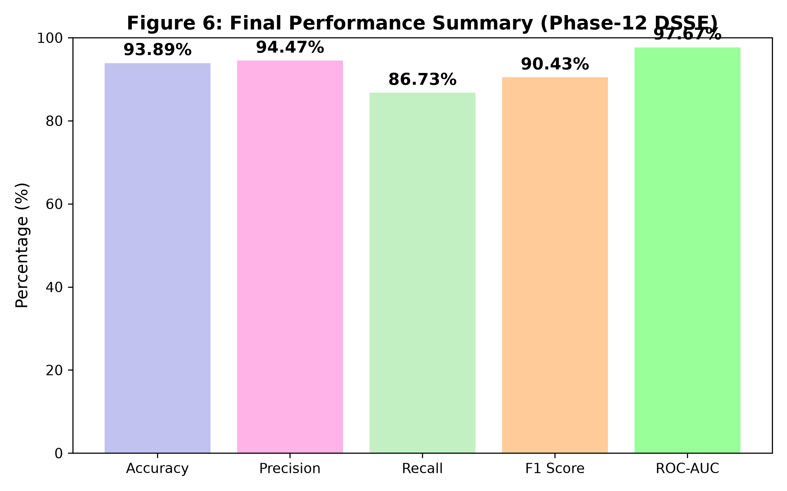

# Dual-Stage Semantic Ensemble with Conformal Selective Routing for Malicious URL Detection

## Abstract
The rapid classification of malicious URLs is a critical component of modern cybersecurity defense. While large language models and transformer-based architectures achieve high semantic comprehension on obfuscated URLs, their computational overhead prohibits inline execution across massive network traffic volumes. We propose the Dual-Stage Semantic Ensemble (DSSE), a cascaded classification architecture that dynamically routes URLs based on structural certainty. DSSE utilizes a lightweight Random Forest structural gatekeeper operating on exactly 12 deterministic URL features. Rather than applying a fixed probability threshold, we wrap this Stage-1 classifier in an Inductive Conformal Prediction (ICP) module. Under standard exchangeability assumptions, this split-conformal construction provides a mathematically rigorous marginal coverage guarantee. Confident structural predictions are short-circuited for immediate decision, while ambiguous URLs are escalated to a Stage-2 semantic classifier utilizing a pre-trained MiniLM transformer. To integrate structural intuition into the semantic space, we employ a Feature-wise Linear Modulation (FiLM) neural network that conditions the dense semantic representations upon the structural feature vector before final classification via XGBoost. Evaluated on a canonical test set of 126,569 URLs, the DSSE achieves an F1 score of 0.9043 and an ROC-AUC of 0.9767. Crucially, the conformal routing policy resolves 96.69% of the queries at the lightweight structural stage, escalating only 3.31% to the transformer. This avoids Stage-2 semantic processing for 96.69% of inputs, limiting deep-learning inference overhead while capturing malicious instances obscured from pure structural analysis. 

## Keywords
Malicious URL Detection, Cybersecurity, Selective Classification, Conformal Prediction, Transformers, Feature Fusion, FiLM, Machine Learning

## 1. Introduction

### 1.1 Problem
Malicious Uniform Resource Locators (URLs) serve as the primary delivery mechanism for phishing, malware distribution, and command-and-control operations. Rapid, inline detection of these URLs is a fundamental requirement for securing enterprise networks and end-user communications.

### 1.2 Existing Approaches
Traditional detection mechanisms relied on deterministic blocklists, which are inherently reactive and fail against ephemeral or zero-day infrastructure. Subsequent efforts shifted to Machine Learning (ML) techniques using lexical and structural analysis, extracting features such as string entropy, special character frequencies, and path depth. Recently, deep learning and transformer-based semantic architectures have emerged. By treating the URL as a sequence of linguistic tokens, these models capture complex obfuscation patterns and semantic mimicry that evade traditional structural heuristics.

### 1.3 Problem with Expensive Semantic Processing
While transformer-based semantic models offer strong detection capabilities, applying a dense neural network (e.g., billions of floating-point operations per URL) to every query in a high-throughput network environment is computationally unviable. The vast majority of URLs are structurally obvious (either clearly benign or blatantly malicious), making heavy semantic processing for every query redundant and inefficient.

### 1.4 Motivation for Selective Routing
Selective classification (or "early exit" routing) addresses this inefficiency by matching computational cost to query difficulty. The core principle is to route structurally obvious, "easy" cases to a cheap, lightweight classifier, reserving expensive, high-capacity semantic analysis exclusively for uncertain, "hard" cases.

### 1.5 Research Gap
While prior works have explored selective classification and transformer-based URL analysis independently, there is a gap in securely calibrating the decision to escalate. Arbitrary probability thresholds often fail to represent true statistical uncertainty. We address this by integrating Inductive Conformal Prediction (ICP) directly into the routing layer, providing statistically grounded uncertainty sets to dictate semantic escalation. Furthermore, instead of discarding the structural features during semantic analysis, we utilize Feature-wise Linear Modulation (FiLM) to actively condition the semantic embeddings.

### 1.6 Contributions
This work makes the following contributions:
1. A lightweight structural Stage-1 gatekeeper utilizing exactly 12 deterministic URL-only features.
2. A conformal routing mechanism for the selective escalation of uncertain queries.
3. The application of MiniLM for the semantic representation of ambiguous URLs.
4. A structural-conditioned FiLM fusion network modulating the semantic representation.
5. An XGBoost Stage-2 classifier operating on the fused embedding space.
6. A measured and statistically verified computation-vs-detection trade-off.

## 2. Related Work

### 2.1 Lexical and Structural URL Detection
Historical approaches rely on extracting structural and lexical features from the URL string, such as length, character distributions, and domain properties, allowing rapid evaluation via tree-based models [1].

### 2.2 Machine Learning for Malicious URL Detection
Extensive literature supports the use of Random Forests, Support Vector Machines, and Gradient Boosting to classify URLs based on manually engineered features [2].

### 2.3 Deep Learning and Transformer-Based URL Detection
Recent advances leverage deep learning, particularly Convolutional Neural Networks (CNNs), Long Short-Term Memory (LSTMs), and Transformer models (e.g., BERT, RoBERTa) to analyze the raw character or sub-word sequence of the URL without manual feature engineering [3].

### 2.4 Selective Classification and Early Exit Systems
Selective classification allows models to abstain from prediction on uncertain inputs [4]. Early exit architectures apply this dynamically, passing inputs through increasingly complex model layers only when confidence is low.

### 2.5 Conformal Prediction for Reliable ML
Conformal prediction is a framework that yields valid, finite-sample prediction sets with user-defined marginal coverage guarantees, regardless of the underlying data distribution or model architecture [5].

### 2.6 Feature Fusion and FiLM-Based Conditioning
Feature-wise Linear Modulation (FiLM) provides a mechanism to condition neural network representations based on auxiliary input, commonly used in visual reasoning and multi-modal tasks [6].

### 2.7 Research Gap
Our work synthesizes these domains, presenting a cascaded architecture where conformal prediction governs the early-exit routing between a structural and a FiLM-fused semantic classifier.

## 3. Problem Formulation

We treat malicious URL classification as a binary classification task. Let $x$ be an input URL string and $y \in \{0, 1\}$ be the corresponding label, where $0$ denotes benign and $1$ denotes malicious. Let $X_{12} \in \mathbb{R}^{12}$ represent the deterministic Stage-1 structural feature vector extracted from $x$.

The Stage-1 classifier $f_{struct}(X_{12})$ emits a probability distribution $p(y | x)$. 

We define a conformal prediction set $\Gamma(x) \subseteq \{BENIGN, MALICIOUS\}$. The routing decision is determined as follows:
- If $\Gamma(x) = \{BENIGN\}$, the system halts and outputs `FINAL_BENIGN`.
- If $\Gamma(x) = \{MALICIOUS\}$, the system halts and outputs `FINAL_MALICIOUS`.
- If $\Gamma(x) = \{BENIGN, MALICIOUS\}$, the query is deemed ambiguous and routes to `NEEDS_STAGE2`.
- If $\Gamma(x) = \emptyset$ (an empty prediction set), the query is theoretically anomalous under the chosen significance level, and is explicitly routed to `NEEDS_STAGE2`.

## 4. Proposed Method

*Figure 1. The overall Dual-Stage Semantic Ensemble (DSSE) architecture, detailing the flow of processing from the initial 12 features and structural gatekeeper through the conformal router, and escalating ambiguous URLs to the FiLM-fused Stage-2 semantic classifier.*

### 4.1 Stage-1 Features
The Stage-1 structural gatekeeper uses exactly 12 deterministically ordered features derived entirely from the URL string. These require no external network calls (DNS, WHOIS, or reputation APIs), minimizing latency.
The features are: 1. `domain_len`, 2. `path_depth`, 3. `special_count_v2`, 4. `token_count`, 5. `url_entropy`, 6. `url_len`, 7. `=`, 8. `.`, 9. `//`, 10. `abnormal_url`, 11. `phish_adv_hyphen_count`, 12. `suspicious_extension`.

*Figure 2. Stage-1 12-Feature Gatekeeper, showing the specific deterministic structural features computed without external context.*

### 4.2 HXRF Stage-1 Gatekeeper
The Stage-1 classifier is a Random Forest (branded here as HXRF) configured with 25 trees and a maximum depth of 20. Its purpose is to perform a highly computationally lightweight structural evaluation of the 12 features. The output probability serves as the foundational metric for the conformal routing layer.

### 4.3 Conformal Selective Routing
We employ an Inductive Conformal Prediction (ICP) methodology to calibrate the routing threshold. We define the nonconformity score function as:
$s(x, y) = 1 - p(y | x)$

Using a disjoint calibration dataset, we calculate the finite-sample corrected quantile threshold $q_\alpha$ for a pre-specified significance level $\alpha$. The canonical ICP model utilizes the exact same HXRF checkpoint for both the calibration and inference phases.

Under the standard exchangeability assumption, the split-conformal construction provides the corresponding marginal coverage guarantee, ensuring that the true class is contained within the prediction set with a probability of at least $1 - \alpha$. 

*Figure 3. Conformal Selective Routing. Uncertain predictions resulting in both classes or an empty prediction set are directly escalated to the Stage-2 semantic classifier.* 

### 4.4 MiniLM Semantic Stage
For URLs escalated to Stage-2, we utilize the pre-trained `all-MiniLM-L6-v2` transformer. The raw URL string is tokenized (truncated to 256 tokens) and processed to extract a 384-dimensional dense semantic representation. This high-capacity linguistic model captures semantic subtleties and obfuscations invisible to the 12 structural heuristics.

### 4.5 FiLM Structural-Semantic Fusion
To avoid discarding the valuable structural context generated in Stage-1, we fuse the structural and semantic domains. We utilize Feature-wise Linear Modulation (FiLM). The structural vector $X_{12}$ is passed through multi-layer perceptrons to generate modulation parameters $\gamma = g(X_{12})$ and $\beta = h(X_{12})$. 
The semantic representation $E_{MiniLM}$ is then subjected to a structural-conditioned modulation of the semantic representation:
$E_{FiLM} = \gamma(X_{12}) \odot E_{MiniLM} + \beta(X_{12})$

*Figure 4. Stage-2 Semantic Fusion Architecture. Demonstrates the structural-conditioned modulation of the semantic representation via the FiLM layer before final XGBoost classification.*

### 4.6 XGBoost Stage 2
The resulting 384-dimensional FiLM-modulated embedding is passed to a final XGBoost classifier. This ensemble model executes the final decision boundary, producing the terminal probability and classification for the ambiguous URL.

## 5. Dataset and Experimental Setup

### 5.1 Dataset
The dataset originates from multiple sources (including ISCX-URL2016, PhishStorm) and was aggressively de-duplicated and split rigorously without leakage.

### 5.2 Experimental Setup
The canonical test suite (`test.parquet`) evaluates the final architecture.
- **Stage-1 Model:** `models/stage1_hxrf.pkl`
- **ICP Model:** `models/stage1_conformal_canonical.pkl`
- **Stage-2 Ensemble:** MiniLM, FiLM (`models/film/film_model.pth`), XGBoost (`models/xgboost_audit/film_xgb.json`).
Experiments were run completely deterministically under fixed OpenMP threading settings and random seeds to secure verifiable reproducibility.

## 6. Results

Using a representative, pre-specified operating point of $\alpha=0.05$, the final canonical DSSE achieves robust classification while minimizing deep learning overhead. 

The Stage-1 gatekeeper successfully resolves 96.69% of all test URLs without semantic processing. The remaining 3.31% are escalated to Stage-2. The end-to-end system achieves an Accuracy of 0.9389, an F1 score of 0.9043, and an ROC-AUC of 0.9767.

*Figure 5. Input Routing Distribution representing the heavy computational avoidance facilitated by the Stage-1 structural resolution.*

*Figure 6. Final Performance Summary of the Phase-12 canonical DSSE.*

A total of 5,043 False Negatives (FN) and 1,670 False Positives (FP) occur at the Stage-1 exit layer. By the end of the DSSE pipeline, the final metrics tally 5,591 FN and 2,137 FP, reflecting the inherited baseline structural errors alongside Stage-2 misclassifications.

## 7. Ablation Study
We historically evaluated the semantic fusion strategy against basic structural concatenation. While concatenation provided a baseline integration of features, the structural-conditioned modulation via FiLM achieved a higher observed F1 score (0.7133 for FiLM vs 0.6925 for concatenation on the isolated Needs-Stage-2 population prior to conformal implementation).

## 8. Error Analysis
Errors persist in the DSSE architecture primarily due to Stage-1 structural limitations. Stage-1 false negatives are not recoverable by the current routing architecture because they are confidently resolved before semantic escalation. These errors therefore propagate to the final system, while additional classification errors may be introduced by Stage 2. (Stage-1 FN = 5,043, Final FN = 5,591).

## 9. Statistical Analysis
McNemar's test identified a statistically significant asymmetry in paired classification disagreements between the repaired canonical ICP configuration and the historical Phase-11A configuration (141 improvements versus 410 regressions, $\chi^2 = 130.35$, $p < 0.001$). This result indicates that the calibration repair materially changed the paired predictions; it should not be interpreted as evidence of superior predictive performance.

## 10. Computational Analysis
The primary contribution of the DSSE architecture is computational efficiency. By resolving 96.69% of inputs at the structural layer, the system avoids Stage-2 semantic processing for 96.69% of inputs, requiring heavy processing for only 3.31% of the workload.

## 11. Security Considerations
Because DSSE operates exclusively on the URL string, it does not rely on external DNS queries, maintaining high resilience against infrastructure latency or external rate-limiting. However, structural features remain highly susceptible to targeted length manipulations and obfuscation by adversaries. 

## 12. Limitations and Threats to Validity

### 12.1 Internal and Statistical Validity
The conformal guarantees are rigorously marginal; they do not apply conditionally per-URL or per-class. 

### 12.2 Construct and External Validity
The validity of the split-conformal guarantee relies on the standard exchangeability assumption between calibration and test examples. Production environments exhibit significant temporal distribution shift, requiring continuous recalibration to maintain valid marginal coverage. Furthermore, adversarial robustness against explicit evasion attacks was not evaluated.

## 13. Discussion
The DSSE architecture demonstrates that a computationally demanding semantic model is unnecessary for the vast majority of network traffic. The 3.31% escalation rate signifies that structural heuristics remain highly predictive for obvious threats. However, the architecture's reliance on Stage-1 confidence is a double-edged sword: structural False Negatives completely bypass semantic recovery. Future improvements must address the structural gatekeeper's false negative rate without expanding the escalation volume.

## 14. Conclusion
The Dual-Stage Semantic Ensemble (DSSE) integrates a lightweight structural Random Forest with a high-capacity MiniLM semantic transformer via conformal selective routing and FiLM-based structural-semantic fusion. By securely bounding uncertainty through Inductive Conformal Prediction, the architecture achieves an F1 score of 0.9043 while restricting deep-learning escalation to only 3.31% of the input volume. 

## References
[1] J. Ma, L. K. Saul, S. Savage, and G. M. Voelker, "Beyond blacklists: learning to detect malicious web sites from suspicious URLs," in *Proceedings of the 15th ACM SIGKDD international conference on Knowledge discovery and data mining*, 2009, pp. 1245-1254. DOI: 10.1145/1557019.1557153.
[2] M. S. I. Mamun, M. A. Rathore, A. H. Lashkari, N. Stakhanova, and A. A. Ghorbani, "Detecting Malicious URLs Using Lexical Analysis," in *International Conference on Network and System Security*, 2016, pp. 467-482. DOI: 10.1007/978-3-319-46298-1_30.
[3] H. Le, Q. Pham, D. Sahoo, and S. C. Hoi, "URLNet: Learning a URL Representation with Deep Learning for Malicious URL Detection," in *2018 IEEE/ACM International Conference on Advances in Social Networks Analysis and Mining (ASONAM)*, 2018. DOI: 10.1109/ASONAM.2018.8508779.
[4] Y. Geifman and R. El-Yaniv, "Selective Classification for Deep Neural Networks," in *Advances in Neural Information Processing Systems*, vol. 30, 2017.
[5] A. N. Angelopoulos and S. Bates, "A Gentle Introduction to Conformal Prediction and Distribution-Free Uncertainty Quantification," *Foundations and Trends in Machine Learning*, vol. 16, no. 4, pp. 494-591, 2023. DOI: 10.1561/2200000101.
[6] E. Perez, F. Strub, H. De Vries, V. Dumoulin, and A. Courville, "FiLM: Visual Reasoning with a General Conditioning Layer," in *Proceedings of the AAAI Conference on Artificial Intelligence*, vol. 32, no. 1, 2018.

---

## Tables

**Table I: Dataset Composition**

| Partition | Total | Benign | Malicious |
| :--- | :--- | :--- | :--- |
| Canonical Test Set | 126,569 | 84,448 | 42,121 |

**Table II: 12 Structural Features**

| Index | Feature Name | Index | Feature Name |
| :--- | :--- | :--- | :--- |
| 1 | domain_len | 7 | = |
| 2 | path_depth | 8 | . |
| 3 | special_count_v2 | 9 | // |
| 4 | token_count | 10 | abnormal_url |
| 5 | url_entropy | 11 | phish_adv_hyphen_count |
| 6 | url_len | 12 | suspicious_extension |

**Table III: Model Comparison**

| Model | F1 | ROC-AUC | Recall | FPR | FNR | Stage-2 % |
| :--- | :--- | :--- | :--- | :--- | :--- | :--- |
| HXRF only (Stage 1) | 0.8872 | 0.9667 | 0.8524 | 0.0326 | 0.1476 | N/A |
| MiniLM + XGB | 0.5842 | 0.7654 | - | - | - | 100% | 
| Concat + XGB | 0.6925 | 0.8381 | - | - | - | 100% |
| FiLM + XGB | 0.7133 | 0.8374 | - | - | - | 100% | 
| Phase-11A canonical DSSE | 0.9077 | 0.9768 | 0.8703 | 0.0236 | 0.1297 | 4.37% |
| Phase-12 canonical ICP DSSE | 0.9043 | 0.9767 | 0.8673 | 0.0253 | 0.1327 | 3.31% |

*(Note: MiniLM, Concat, and FiLM baselines represent historical isolated subset metrics and are NOT DIRECTLY COMPARABLE to the end-to-end evaluations)*

**Table IV: Final Canonical DSSE Results**

| Metric | Value |
| :--- | :--- |
| Accuracy | 93.89% |
| Precision | 94.47% |
| Recall | 86.73% |
| F1 Score | 90.43% |
| ROC-AUC | 97.67% |

**Table V: Routing / Computational Trade-off**

| Routing Decision | Percentage |
| :--- | :--- |
| Stage-1 Resolution | 96.69% |
| Stage-2 Escalation | 3.31% |

**Table VI: Error Analysis**

| Error Type | Stage-1 Intercepted | Final DSSE Pipeline |
| :--- | :--- | :--- |
| False Negatives (FN) | 5,043 | 5,591 |
| False Positives (FP) | 1,670 | 2,137 |
