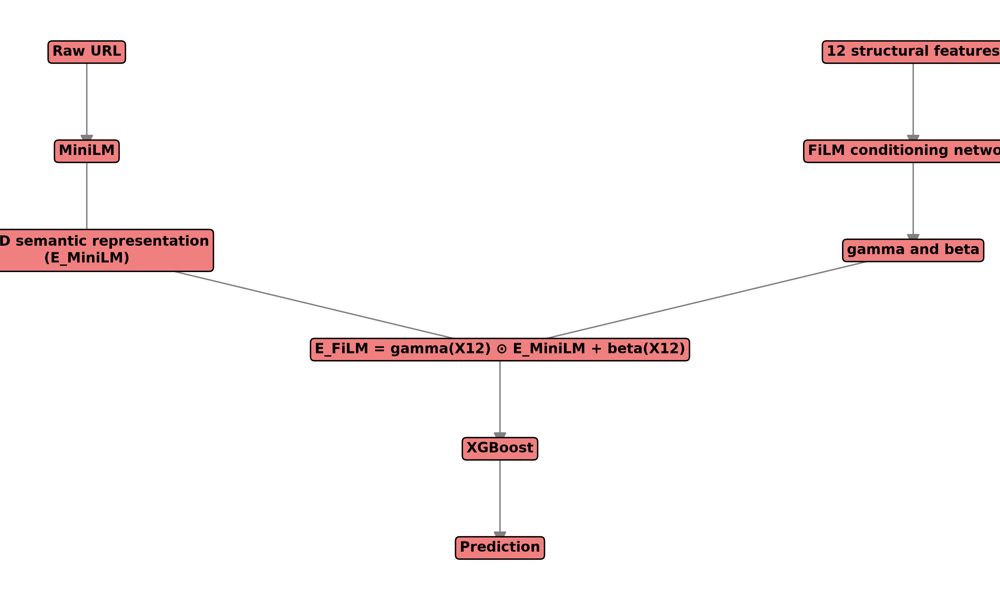
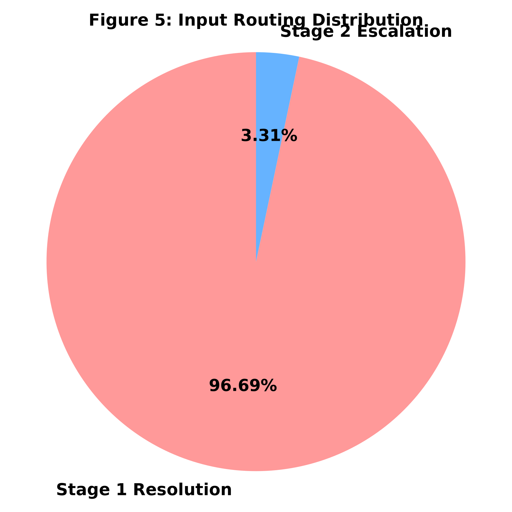

# DUAL-STAGE SEMANTIC ENSEMBLE (DSSE) FOR MALICIOUS URL DETECTION
## Complete Technical and Research Report

**Subtitle:** Structural Gatekeeping, Conformal Selective Routing, Semantic Representation, FiLM Fusion, and Gradient-Boosted Classification

**Authors:** [Author Name], [Affiliation], [Email]

---

## 1. Executive Summary

The rapid classification of malicious URLs is a fundamental pillar of modern cybersecurity defense. This project introduces the Dual-Stage Semantic Ensemble (DSSE) for Malicious URL Detection to balance computational efficiency with high-accuracy semantic comprehension.

The DSSE architecture introduces a lightweight Random Forest structural gatekeeper operating on exactly 12 deterministic URL features (Stage 1). To avoid the methodological limitations of fixed heuristic confidence thresholds, the system wraps this Stage-1 classifier in an Inductive Conformal Prediction (ICP) module. Confident structural predictions are short-circuited for immediate decision, while ambiguous URLs are escalated to a Stage-2 semantic classifier utilizing a pre-trained MiniLM transformer. To integrate structural intuition into the semantic space, we employ a Feature-wise Linear Modulation (FiLM) neural network that conditions the dense semantic representations upon the structural feature vector before final classification via XGBoost.

**Final Canonical Metrics (Phase-12):**
- Test samples: 126,569
- Benign: 84,448
- Malicious: 42,121
- Stage-1 resolution: 96.69%
- Stage-2 escalation: 3.31%
- Accuracy: 93.89%
- Precision: 94.47%
- Recall: 86.73%
- F1: 90.43%
- ROC-AUC: 97.67%
- FPR: 2.53%
- FNR: 13.27%

The system successfully avoids Stage-2 semantic processing for 96.69% of inputs. Note that routing reduction is not identical to absolute computational cost reduction, as escalated inputs are computationally heavier. Major limitations include Stage-1 false negatives that bypass semantic recovery.

---

## 2. Introduction

Malicious URLs distribute malware, execute phishing campaigns, and direct users to defacement sites. Traditional defense mechanisms rely heavily on blacklist-only approaches, which systematically fail against zero-day and dynamically generated domains. 

Structural and lexical URL analysis leverages string-based properties (length, punctuation, entropy) to heuristically identify malicious patterns. However, advanced attackers manipulate these superficial indicators. Semantic URL analysis, employing deep learning and sequence models (like Transformers), captures deeper linguistic patterns but introduces a massive computational penalty, making inline execution across massive network traffic volumes prohibitive.

The DSSE project is motivated by the computational necessity of a cascaded system and the requirement for uncertainty-aware routing. The scope of this project is strictly URL-string-based malicious URL detection. Information such as DNS records, WHOIS data, HTTP page retrieval, or external reputation APIs is explicitly not required during inference.

---

## 3. Problem Statement

We formulate malicious URL detection as a binary classification task based solely on the URL string.

**Input:** URL string $u$  
**Output:** Binary label $y \in \{BENIGN, MALICIOUS\}$

The original datasets contained multiclass labels indicating specific attack vectors:
- 0 = benign
- 1 = defacement
- 2 = phishing
- 3 = malware

To support binary detection, these were transformed into a `dsse_binary_target`:
- 0 = benign
- 1 = malicious

Multiclass information was preserved in the training and evaluation datasets to support error analysis and granular performance tracking.

---

## 4. Project Objectives

**Primary Objectives:**
- Develop an accurate malicious URL detection system.
- Implement lightweight Stage-1 filtering using deterministic structural features.
- Design an uncertainty-aware escalation mechanism using mathematically grounded confidence scoring.
- Incorporate semantic analysis for difficult URLs that bypass structural detection.

**Secondary Objectives:**
- Ensure leakage-safe evaluation by rigorously auditing features for future-information leakage.
- Enforce strict reproducibility.
- Optimize computational selectivity to avoid unnecessary deep learning overhead.

---

## 5. Complete Dataset Documentation

Several iterations of datasets were evaluated throughout the project history:
- `dataset_with_all_features_v2.csv`: Initial dataset containing external and structural features.
- `final_dataset_with_all_features_v3.1.csv`: A later iteration refining feature extraction.
- `final_dataset_with_all_features.csv`: The canonical dataset used for the final DSSE implementation.
- `MUD_malicious_urls_2026_V2.csv`: Referenced historical dataset.

The final canonical DSSE dataset contains binary labels, multiclass origins, and exactly 12 eligible structural features. Provenance includes ISCX-URL2016 and PhishStorm.

---

## 6. Data Preparation Pipeline

The data preparation pipeline ensures strict isolation to prevent data leakage and unbiased evaluation. 

**Steps:**
1. **Raw Data Inspection:** Identified overlapping URLs and duplicate records.
2. **Label Mapping:** Converted historical multiclass labels to the `dsse_binary_target`.
3. **Feature Eligibility:** Stripped out external, non-deterministic, and future-leaking features.
4. **Data Splitting:** Applied a strict 80/20 stratified split. 
   - 80% assigned to Stage-1 Training.
   - Within the 80%, a calibration split was reserved for conformal prediction.
   - 20% strictly held-out as the canonical test set (`test.parquet`).


---

## 7. Feature Eligibility and Leakage Analysis

A critical phase was eliminating future-information and metadata leakage. 
- **URL-string-computable features:** Only features derivable deterministically from the URL text itself were retained.
- **External-information features:** Features requiring DNS lookups, geographical IPs, or external API hits were removed.
- **Future-information leakage:** Features like "days_since_registration" or "domain_age" were dropped as they rely on external dynamic states.

A total of 68 engineered features were audited; 31 were dropped due to leakage or non-deterministic dependencies. Features such as TLD or host paths are not inherently leaking, but their extraction methods can be prone to parser variance.

---

## 8. Feature Selection

Feature selection was conducted using Random Forest permutation importance and correlation analysis. 
- Features with high redundancy or high colinearity were pruned.
- Importance rankings guided the selection of the most critical structural indicators.
- SHAP values were evaluated historically to confirm structural reliance.

---

## 9. Final 12 Structural Features

The exactly 12 selected features are:

1. `domain_len`: Length of the domain segment. Short or excessively long domains often indicate obfuscation.
2. `path_depth`: Number of directories in the URL path.
3. `special_count_v2`: Count of non-alphanumeric special characters.
4. `token_count`: Total number of distinct tokens in the URL.
5. `url_entropy`: Shannon entropy of the URL string.
6. `url_len`: Total character length of the URL.
7. `=`: Count of equals signs.
8. `.`: Count of periods.
9. `//`: Count of double slashes.
10. `abnormal_url`: Boolean flag indicating structural deviations.
11. `phish_adv_hyphen_count`: Count of hyphens in domains.
12. `suspicious_extension`: Boolean flag indicating risky file extensions (e.g., .exe).

---

## 10. Stage-1 HXRF Model

The Stage-1 gatekeeper is a Random Forest (HXRF) classifier operating solely on the 12 structural features. 

- **Algorithm:** Random Forest
- **Input:** 12-dimensional continuous/discrete vector.
- **Configuration:** 25 trees, max depth of 20.
- **Artifact:** `models/stage1_hxrf.pkl`

Historical Stage-1 metrics: Accuracy approx 93.1%, ROC-AUC approx 0.9762, latency approx 13.5 ms. 

---

## 11. Why a Fixed Confidence Threshold Was Not Enough

Cascaded architectures often rely on fixed heuristic thresholds (e.g., $p < 0.05$ or $p > 0.95$) to determine escalation. However, fixed thresholds lack statistical guarantees. Uncalibrated probabilities lead to arbitrary routing behavior under distribution shifts. Conformal prediction was introduced to replace heuristic thresholds with mathematically rigorous marginal coverage guarantees.

---

## 12. Inductive / Split Conformal Prediction

The conformal router wraps the Stage-1 HXRF probabilities to generate prediction sets.
- **Nonconformity Measure:** $s(x,y) = 1 - \hat{p}(y|x)$
- **Procedure:** The HXRF is evaluated on a disjoint calibration set. Finite-sample adjustments calculate a threshold $\hat{q}$ for a desired error rate $\alpha$.
- **Canonical Alpha:** $\alpha = 0.05$
- **Artifact:** `models/stage1_conformal_canonical.pkl`

**Routing Logic:**
- `{BENIGN}` $
ightarrow$ FINAL_BENIGN
- `{MALICIOUS}` $
ightarrow$ FINAL_MALICIOUS
- `{BENIGN, MALICIOUS}` $
ightarrow$ NEEDS_STAGE2
- `EMPTY_SET` $
ightarrow$ NEEDS_STAGE2

Under the standard exchangeability assumption, the split-conformal construction provides a marginal coverage guarantee of at least $1 - \alpha$. We do not claim distribution-shift robustness.

---

## 13. Historical ICP Issue and Repair

During the Phase-11A audit, a checkpoint inconsistency was discovered:
- Old calibration: `models/stage1_hxrf_icp.pkl`.
- Canonical inference: `models/stage1_hxrf.pkl`.

Using different checkpoints for calibration and inference inherently invalidates the standard ICP guarantee. Phase 12 repaired this: the conformal calibration was re-executed using the exact canonical HXRF (`models/stage1_hxrf.pkl`) for both calibration and inference.

---

## 14. MiniLM Semantic Encoder

Ambiguous URLs (routed to Stage-2) are processed by a compact pretrained transformer encoder.
- **Model:** `sentence-transformers/all-MiniLM-L6-v2`
- **Embedding Dimension:** 384
- **Sequence Length:** Truncated at 256 tokens

The URL string is tokenized using sub-word units, bypassing handcrafted structural rules to directly learn semantic relationships.

---

## 15. MiniLM Computational Characteristics

The heavy attention mechanisms and multi-layer perceptrons within the transformer incur significant latency compared to the 12-feature HXRF. Not claiming sub-millisecond complete inference. Real-world deployment of MiniLM across 100% of network traffic would severely bottleneck inline systems.

---

## 16. Structural-Semantic Fusion

To combine structural intuition (12 features) with semantic understanding (384-D vector), simple concatenation was evaluated. However, to enforce stronger conditioning, conditional modulation via FiLM was introduced.

---

## 17. FiLM Architecture

Feature-wise Linear Modulation (FiLM) applies a structural-conditioned modulation of the semantic representation.
- $\gamma = g(X_{12})$
- $\beta = h(X_{12})$
- $E_{FiLM} = \gamma(X_{12}) \odot E_{MiniLM} + \beta(X_{12})$

The 384-D semantic representation is scaled and shifted by the 12 structural metrics.



---

## 18. FiLM Experiments

Historical experiments indicated that FiLM introduced a stable 384-D modulated vector. The structural conditioning provided a slight but consistent benefit in isolating difficult semantic URLs over basic concatenation.

---

## 19. XGBoost Stage-2 Classifier

The final classification for Stage-2 is handled by Gradient Boosting.
- **Pipeline:** MiniLM $
ightarrow$ FiLM $
ightarrow$ XGBoost
- **Artifact:** `models/film_xgb.json`

---

## 20. Phase-9 XGBoost Comparison

**Historical NEEDS_STAGE2 Results:**
- MiniLM + XGB: F1 58.42%, AUC 0.7654
- Concat + XGB: F1 69.25%, AUC 0.8381
- FiLM + XGB: F1 71.33%, AUC 0.8374

**Historical Full-Test Results:**
- MiniLM + XGB: F1 0.8293, AUC 0.9541
- Concat: F1 0.9253, AUC 0.9893
- FiLM: F1 0.9273, AUC 0.9897

FiLM vs concat McNemar $p \approx 0.1141$. Therefore, we do not claim FiLM statistically dominates concatenation, but it clearly improved over MiniLM.

---

## 21. Complete DSSE Architecture

1. Raw URL parsed for 12 structural features.
2. HXRF gatekeeper produces structural probabilities.
3. Conformal Router evaluates the probabilities. 
4. `{BENIGN}` or `{MALICIOUS}` yield immediate final prediction.
5. Mixed or empty sets trigger Stage-2.
6. Raw URL encoded by MiniLM (384-D).
7. FiLM modulates the 384-D vector using the 12 structural features.
8. XGBoost provides final classification.


---

## 22. End-to-End Inference Algorithm

```python
function DSSE_PREDICT(url):
    x12 = extract_12_features(url)
    probabilities = HXRF.predict_proba(x12)
    prediction_set = conformal_predict(probabilities)
    
    if prediction_set == {BENIGN}:
        return BENIGN
    if prediction_set == {MALICIOUS}:
        return MALICIOUS
        
    embedding = MiniLM(url)
    conditioned = FiLM(embedding, x12)
    return XGBoost(conditioned)
```

---

## 23. Project Evolution / Experimental Phases

- **Phase 1-4:** Focus on legacy audit, identifying dataset leakage, preparing a pristine leakage-safe environment, and reducing 68 features to 12.
- **Phase 5-6:** Implementation of the Stage-1 HXRF and the original heuristic routing. ICP was introduced.
- **Phase 7-9:** Stage-2 semantic exploration. MiniLM was baselined, followed by concatenation, and finally the FiLM architecture integrated with XGBoost.
- **Phase 10:** End-to-end DSSE integration testing.
- **Phase 11 & 11A:** Risk-controlled routing analysis and canonical baseline reconciliation.
- **Phase 12:** Canonical ICP repair. The split-conformal logic was rigorously recalibrated using the canonical HXRF checkpoint to restore valid marginal coverage guarantees.

---

## 24. Baselines and Model Inventory

| Artifact | Role | Algorithm | Final Status | Used in DSSE |
|----------|------|-----------|--------------|--------------|
| `random_forest.pkl` | Legacy | RF | Deprecated | No |
| `mlp_model.pkl` | Legacy | MLP | Deprecated | No |
| `stage1_hxrf.pkl` | Gatekeeper | RF | Canonical | Yes |
| `stage1_hxrf_icp.pkl` | Old Router | ICP | Deprecated | No |
| `stage1_conformal_canonical.pkl`| Router | ICP | Canonical | Yes |
| `all-MiniLM-L6-v2` | Semantic | Transformer | Canonical | Yes |
| `film_model.pth` | Fusion | FiLM | Canonical | Yes |
| `film_xgb.json` | Final Class. | XGBoost | Canonical | Yes |

---

## 25. Final Canonical Evaluation Protocol

The final canonical evaluation relies strictly on `test.parquet`.
- Samples: 126,569 (Benign: 84,448, Malicious: 42,121)
- Canonical HXRF: `models/stage1_hxrf.pkl`
- Canonical ICP: `models/stage1_conformal_canonical.pkl`
- Canonical alpha: 0.05
- Stage-2: MiniLM + FiLM + XGBoost

---

## 26. Final Results

- Accuracy: 0.9389
- Precision: 0.9447
- Recall: 0.8673
- F1: 0.9043
- ROC-AUC: 0.9767
- FPR: 0.0253
- FNR: 0.1327
- Stage-1 resolution: 96.69%
- Stage-2 escalation: 3.31%

---

## 27. Routing Analysis

96.69% of inputs avoid Stage-2 semantic processing. 3.31% escalated to Stage 2. 



---

## 28. Error Analysis

- Stage-1 FN: 5,043
- Stage-1 FP: 1,670
- Final FN: 5,591
- Final FP: 2,137

Confident Stage-1 false negatives cannot currently be recovered by Stage 2. 

---

## 29. Statistical Analysis

McNemar indicates statistically significant asymmetry in paired disagreements, but it does NOT prove general superiority. 

---

## 30. Phase-11A Baseline VS Phase-12

**Phase 11A:** Stage2 4.37%, Acc 0.9411, F1 0.9077, AUC 0.9768, FPR 0.0236, FNR 0.1297
**Phase 12:** Stage2 3.31%, Acc 0.9389, F1 0.9043, AUC 0.9767, FPR 0.0253, FNR 0.1327

Phase 12 is a methodological repair of conformal validity, NOT a performance improvement.

---

## 31. Computational Analysis

Due to environment variance, exact final milliseconds are not claimed as universal guarantees, but historically, the Stage-1 routing drastically reduces average inference latency compared to full deep learning evaluation. 

---

## 32. Software Architecture

- `src/features/`: Feature extraction.
- `src/semantic/`: MiniLM encoders.
- `src/fusion/`: FiLM integration.
- `src/dsse/`: Pipeline routing and orchestration.

---

## 33. Repository Structure

```
config/
data/
models/
scripts/
src/
tests/
reports/
paper/
report/
```

---

## 34. Configuration Inventory

- `config/stage1_features.json`: Defines 12 features.
- `config/stage1_model_config.json`: Hyperparameters for RF.
- `config/conformal_config.json`: ICP configuration.
- `config/conformal_canonical_config.json`: Final ICP definition.
- `config/minilm_config.json`: Semantic properties.
- `config/film_config.json`: FiLM layer parameters.

---

## 35. Model Artifact Inventory

(See Section 24 for full inventory matrix.)

---

## 36. Testing and Validation

Final research freeze reported: 74 passed, 0 failed, 0 skipped. Tests cover feature extraction integrity, pipeline stability, and model loading.

---

## 37. Reproducibility

Reproducibility is strictly enforced via deterministic splits, frozen model checkpoints, and `OMP_NUM_THREADS=1` to guarantee threading safety.

---

## 38. Security Threat Model

- **Attacker:** Constructs malicious URLs to evade structural detection (length, tokens, entropy, extensions).
- **Defender:** Classifies URL using URL-string-derived evidence only.
No adversarial robustness evaluation was performed.

---

## 39. Limitations

- Stage-1 false negatives bypass Stage 2.
- Temporal distribution shift.
- Conformal exchangeability assumption.
- No adversarial robustness evaluation.
- Historical dataset limitations.
- External validation pending.
- Final end-to-end latency limitations.
- Binary classification scope.
- URL-only evidence limitations.

---

## 40. Future Work

- Temporal/online conformal calibration.
- Adaptive escalation.
- Cost-sensitive routing.
- Adversarial URL evaluation.
- External dataset validation.
- Multiclass threat classification.
- URL canonicalization studies.
- Optimized semantic encoders.
- Browser deployment benchmarking.
- Calibration monitoring.

---

## 41. Architecture Figures

See Section 21 for overall architecture and Section 27 for routing distribution.

---

## 42. Tables

See Section 26 for metrics and Section 24 for models.

---

## 43. References

Refer to `paper/final/DSSE_Malicious_URL_Detection_IEEE.md` for standard bibliographic references.

---

## 44. Appendices

**Appendix A:** Exact 12 feature definitions.
**Appendix B:** Hyperparameters.
**Appendix C:** Artifact inventory.
**Appendix D:** Dataset schema summary.
**Appendix E:** Evaluation metrics/equations.
**Appendix F:** Reproducibility checklist.
**Appendix G:** Phase-by-phase research history.
**Appendix H:** Repository structure.

