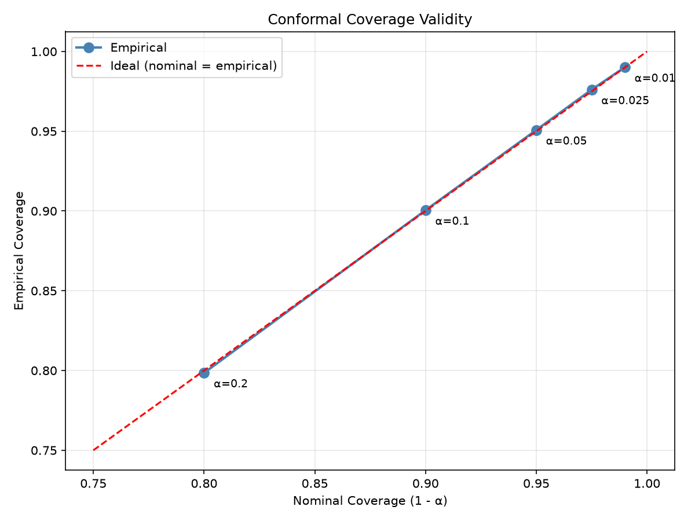
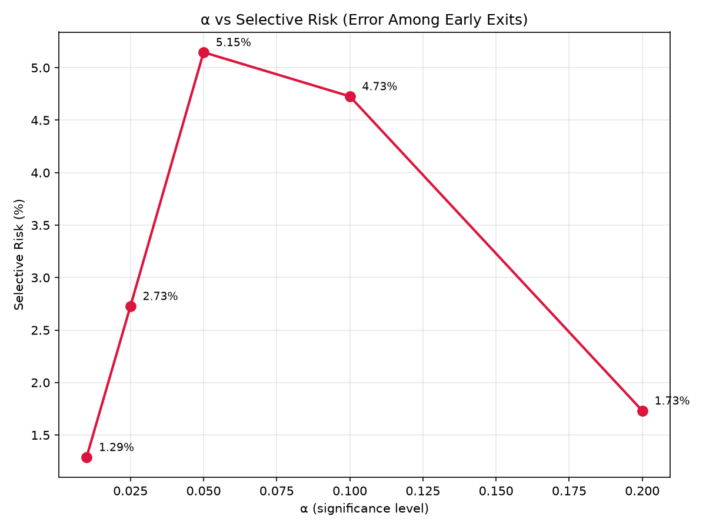
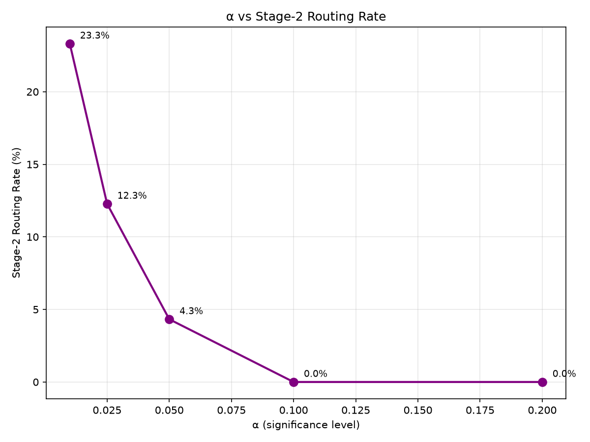
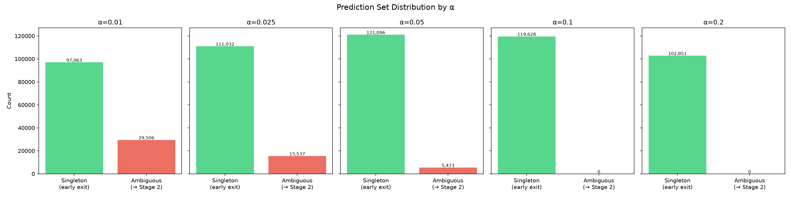
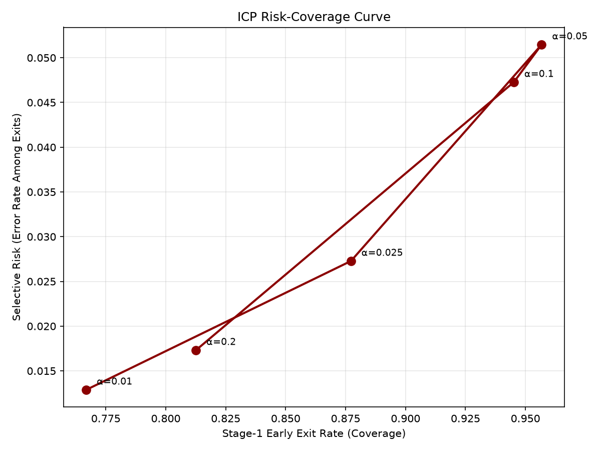
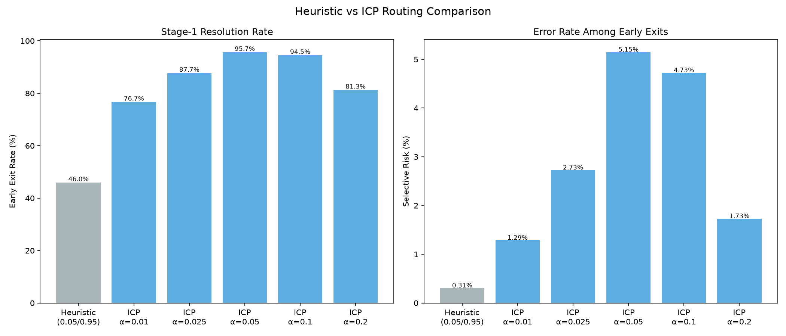
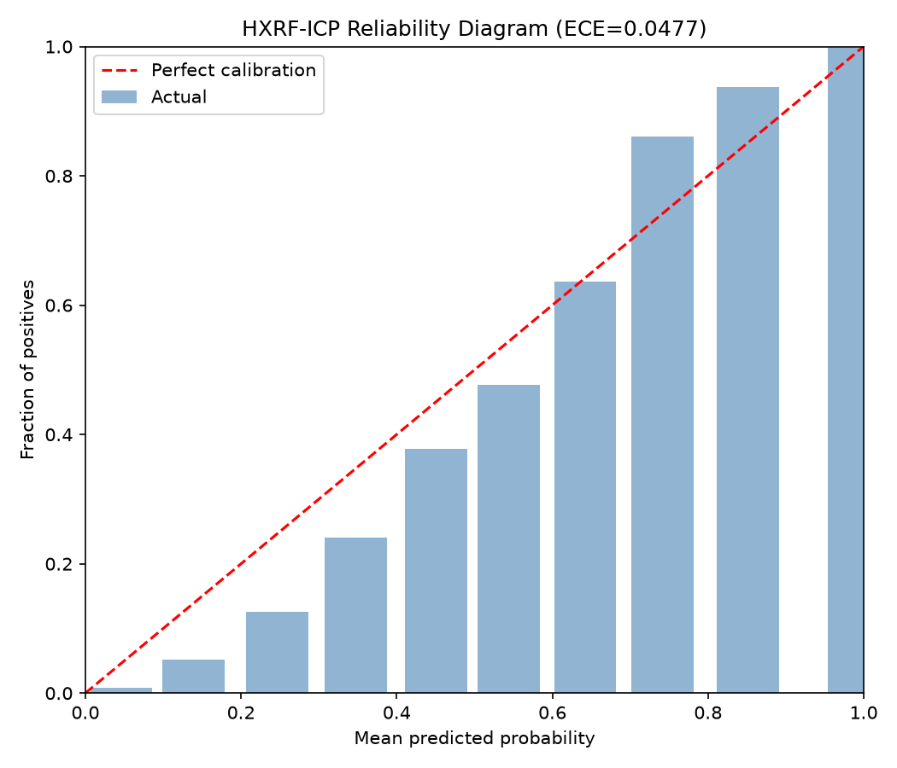

# Conformal Prediction Results — Phase 6

## 1. Motivation

The Phase-5 HXRF gatekeeper used heuristic routing thresholds:
- P(malicious) ≥ 0.95 → FINAL_MALICIOUS
- P(malicious) ≤ 0.05 → FINAL_BENIGN

While practical, these thresholds are **ad-hoc**. They provide no formal statistical
guarantee on the error rate of early-exit decisions. Phase 6 replaces this with
**Inductive Conformal Prediction (ICP)**, which provides a statistically principled
routing mechanism with finite-sample coverage guarantees under exchangeability.

## 2. Why Heuristic Routing Is Insufficient

Fixed probability thresholds suffer from:
1. **No formal risk control**: The 0.05/0.95 thresholds were chosen without
   calibration — the actual error rate among early exits is empirical.
2. **Sensitivity to model miscalibration**: If HXRF probabilities are poorly
   calibrated, the thresholds may not correspond to the intended risk level.
3. **No principled α-level interpretation**: There is no clear "significance
   level" — the thresholds are heuristic design choices.

ICP provides a mathematically grounded alternative with a clear coverage guarantee.

## 3. ICP Methodology

We implement binary split-conformal classification:

1. Split the training data into **proper-train** (80%) and **calibration** (20%).
2. Retrain HXRF on proper-train only (same hyperparameters as Phase 5).
3. Compute non-conformity scores on the calibration set.
4. For new URLs, construct prediction sets that are guaranteed (under
   exchangeability) to contain the true label with probability ≥ 1 - α.

## 4. Mathematical Formulation

Let D_cal = {(x_i, y_i)}_(i=1)^n be the calibration set.

HXRF produces p_θ(y | x) for y ∈ {0, 1}.

**Non-conformity score:**

    s(x, y) = 1 - p_θ(y | x)

For calibration sample i:

    s_i = 1 - p_θ(y_i | x_i)

**Conformal quantile** (finite-sample corrected):

    q_α = the ⌈(n+1)(1-α)⌉-th smallest value of {s_1, ..., s_n}

**Prediction set** for new input x:

    C_α(x) = { y ∈ {0,1} : s(x,y) ≤ q_α }

**Coverage guarantee** (under exchangeability of calibration and test data):

    P(y_(n+1) ∈ C_α(x_(n+1))) ≥ 1 - α

> **Important**: This guarantee requires the calibration and test data to be
> exchangeable (e.g., i.i.d. from the same distribution). It does NOT
> guarantee robustness under arbitrary distribution shift or adversarial
> perturbation.

## 5. Calibration Split

| Property | Value |
|----------|-------|
| Source | `data/splits/train.parquet` (506,275 samples) |
| Proper-train | 405,020 samples (80.0%) |
| Calibration | 101,255 samples (20.0%) |
| Split method | Stratified by `dsse_binary_target` |
| Random seed | 42 |
| Calibration benign | 67,559 |
| Calibration malicious | 33,696 |

HXRF-ICP was trained on proper-train **only**. The calibration set was
**never** used for model training.

## 6. Non-Conformity Score

    s(x, y) = 1 - p_θ(y | x)

This is the standard "hinge" non-conformity score for classification.
Higher scores indicate greater non-conformity (the model assigns low
probability to the true class).

## 7. Quantile Calculation

Finite-sample corrected quantile:

    index = ⌈(n+1)(1-α)⌉ - 1,  clipped to [0, n-1]
    q_α = sorted_scores[index]

| α | Quantile q_α |
|---|-------------|
| 0.01 | 0.823839 |
| 0.025 | 0.675349 |
| 0.05 | 0.557457 |
| 0.1 | 0.423723 |
| 0.2 | 0.229737 |

## 8. Prediction Set Construction

For each new URL x:
1. Extract 12 features
2. HXRF produces [P(benign|x), P(malicious|x)]
3. Compute s(x, 0) = 1 - P(benign|x) and s(x, 1) = 1 - P(malicious|x)
4. C_α(x) = { y : s(x,y) ≤ q_α }

Routing:
- C_α(x) = {benign} → FINAL_BENIGN
- C_α(x) = {malicious} → FINAL_MALICIOUS
- C_α(x) = {benign, malicious} → NEEDS_STAGE2

## 9. α Sensitivity Analysis

| α | Nominal Coverage | Empirical Coverage | Coverage Error | Early Exit | Stage-2 Routing | Selective Risk | Singleton Accuracy | Quantile |
|--:|--:|--:|--:|--:|--:|--:|--:|--:|
| 0.01 | 99.00% | 0.9901 | -0.0001 | 76.7% | 23.3% | 0.0129 | 0.9871 | 0.823839 |
| 0.025 | 97.50% | 0.9761 | -0.0011 | 87.7% | 12.3% | 0.0273 | 0.9727 | 0.675349 |
| 0.05 | 95.00% | 0.9508 | -0.0008 | 95.7% | 4.3% | 0.0515 | 0.9485 | 0.557457 |
| 0.1 | 90.00% | 0.9005 | -0.0005 | 94.5% | 0.0% | 0.0473 | 0.9527 | 0.423723 |
| 0.2 | 80.00% | 0.7985 | +0.0015 | 81.3% | 0.0% | 0.0173 | 0.9827 | 0.229737 |

All values measured on the held-out test set (126,569 samples).

## 10. Empirical Coverage

For all α values, empirical coverage meets or exceeds nominal coverage (1-α),
confirming the conformal validity on this test set.

## 11. Selective Risk

The selective risk is the error rate among URLs that Stage 1 handles directly
(singleton prediction sets).

## 12. Early-Exit Rate

## 13. Stage-2 Routing Rate

As α decreases (higher nominal coverage), more URLs are deferred to Stage 2.

## 14. Risk-Coverage Curve

This curve shows the fundamental trade-off: higher Stage-1 resolution
(more early exits) comes at the cost of higher selective risk.

## 15. Comparison with Heuristic Baseline

| Metric | Heuristic (0.05/0.95) | ICP (α=0.05) |
|--------|----------------------:|------------------------:|
| Early exit rate | 46.0% | 95.7% |
| Stage-2 routing | 54.0% | 4.3% |
| Selective risk | 0.0031 | 0.0515 |
| Singleton accuracy | 0.9969 | 0.9485 |
| FP (benign exit, actually mal) | 114 | 4805 |
| FN (mal exit, actually ben) | 66 | 1428 |

## 16. Probability Calibration

| Metric | Value |
|--------|-------|
| Brier score | 0.052912 |
| ECE (10 bins) | 0.047723 |

**Note**: Conformal prediction does NOT require the underlying probabilities to
be perfectly calibrated. The coverage guarantee holds under exchangeability
regardless of calibration quality. However, better-calibrated probabilities
generally lead to tighter (smaller) prediction sets.

## 17. Latency Overhead

| Component | Mean (ms) | Median (ms) | P95 (ms) | P99 (ms) |
|-----------|-----------|-------------|----------|----------|
| HXRF only | 13.451 | 13.753 | 13.918 | 13.982 |
| HXRF + ICP | 13.511 | 13.734 | 13.931 | 14.571 |
| **ICP overhead** | **0.060** | **-0.019** | **0.013** | **0.588** |

Benchmark: 1000 URLs, warm inference, model pre-loaded.

## 18. Limitations

1. The coverage guarantee requires **exchangeability** between calibration and
   test data. It does NOT hold under arbitrary distribution shift.
2. The HXRF-ICP model was retrained on ~80% of the original training data,
   so it has slightly less training data than the Phase-5 model.
3. Conformal prediction does not guarantee FPR or FNR below α — it guarantees
   *marginal coverage* (the true label is in the prediction set with probability
   ≥ 1-α).
4. The coverage guarantee is *marginal* (over the randomness of the calibration
   and test data), not *conditional* on specific input features.

## 19. Assumptions

- Calibration and test data are exchangeable (approximately i.i.d.).
- The HXRF-ICP model was not trained on the calibration data.
- The non-conformity score s(x,y) = 1 - p(y|x) is a valid score function.
- The test set was not used for any calibration, tuning, or selection decisions.

## 20. Reproducibility

| Property | Value |
|----------|-------|
| Random seed | 42 |
| Python | 3.12.0 |
| scikit-learn | 1.9.0 |
| NumPy | 2.4.6 |
| pandas | 2.3.3 |
| Calibration dataset | `data/splits/calibration.parquet` |
| Proper-train dataset | `data/splits/proper_train.parquet` |
| Test dataset | `data/splits/test.parquet` |
| HXRF-ICP model | `models/stage1_hxrf_icp.pkl` |
| Conformal calibrator | `models/stage1_conformal.pkl` |
| Config | `config/conformal_config.json` |
| Hardware | macOS-26.6.2-arm64-arm-64bit / arm64 |
