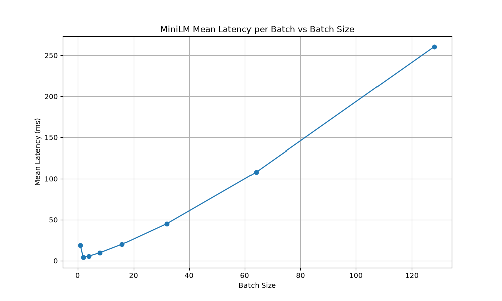
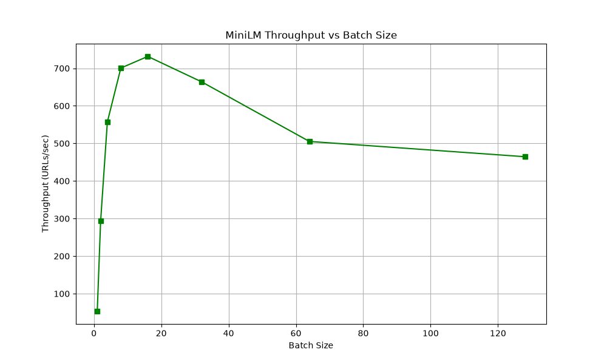
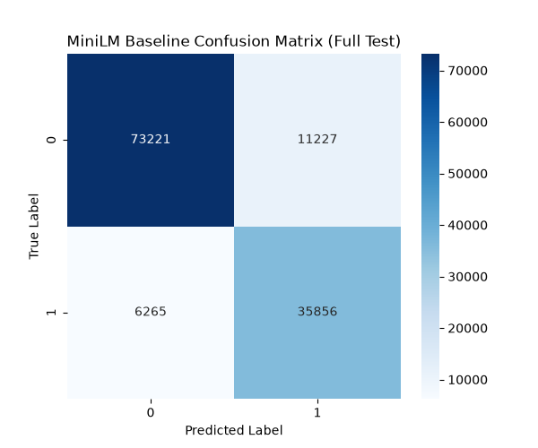

# Stage-2 Semantic Representation — MiniLM Baseline

## 1. Motivation
Introduce a deep semantic encoder to process raw URLs for the NEEDS_STAGE2 subset to catch sophisticated malicious patterns missed by structural analysis.

## 2. Model & Settings
- Model: `sentence-transformers/all-MiniLM-L6-v2`
- Embedding Dimension: 384
- Max Sequence Length: 256
- Device: mps
- Normalization: False

## 3. Dataset Storage Analysis
- Full 632k dataset ~972 MB (uncompressed float32)
- Test set (126k) ~194 MB
- NEEDS_STAGE2 subset (5473) ~8.02 MB

## 4. Latency & Throughput Benchmark
| Batch Size | Mean (ms/batch) | Median (ms/batch) | P95 (ms/batch) | P99 (ms/batch) | Throughput (URLs/sec) |
|------------|-----------------|-------------------|----------------|----------------|-----------------------|
| 1 | 18.76 | 5.00 | 93.25 | 117.57 | 53.32 |
| 2 | 4.20 | 4.03 | 5.50 | 6.88 | 293.36 |
| 4 | 5.54 | 4.94 | 9.11 | 10.75 | 557.11 |
| 8 | 9.73 | 8.23 | 15.37 | 20.21 | 700.53 |
| 16 | 20.17 | 18.04 | 34.02 | 39.47 | 731.53 |
| 32 | 45.22 | 40.94 | 71.28 | 77.49 | 663.87 |
| 64 | 107.77 | 104.12 | 149.29 | 155.54 | 505.21 |
| 128 | 260.55 | 260.55 | 305.94 | 309.97 | 464.60 |

## 5. Classification Metrics
Baseline model: Logistic Regression trained on 50,000 URLs.

| Metric | Full Test Set | NEEDS_STAGE2 Subset |
|--------|---------------|---------------------|
| Accuracy | 0.8618 | 0.6636 |
| ROC-AUC | 0.9376 | 0.7261 |
| Precision | 0.7615 | 0.6005 |
| Recall | 0.8513 | 0.6086 |
| F1 Score | 0.8039 | 0.6045 |
| Specificity | 0.8671 | 0.7039 |
| FPR | 0.1329 | 0.2961 |
| FNR | 0.1487 | 0.3914 |

## 6. Tokenization Analysis
Avg tokens: 27.99, Truncated: 0.07%

