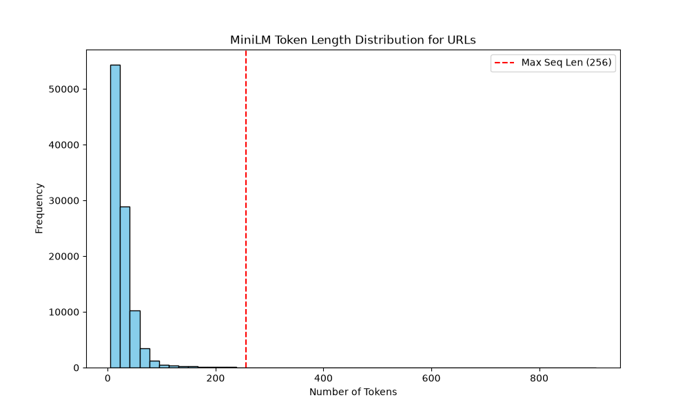

# MiniLM Tokenization Analysis

## Token Length Statistics
- **Max Configured Token Length:** 256
- **Average Token Count:** 27.99
- **Median Token Count:** 21.00
- **P95 Token Count:** 64.00
- **Maximum Observed Token Count:** 905
- **Percentage Truncated:** 0.07%

